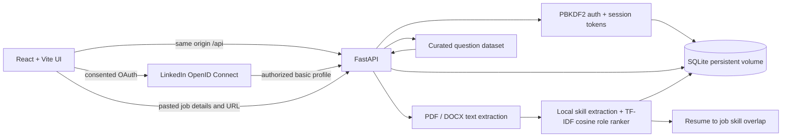

# CareerSage system architecture and workflow

## Architecture

The MVP is one deployable service. Vite builds the React 19 client into static assets; FastAPI serves those assets and `/api/*` routes from the same origin. This removes cross-origin setup for the normal deployment. SQLite persists accounts, revocable bearer sessions, resume analyses, and answer evaluations in the mounted `data` volume. The backend uses only local processing and needs no paid AI key.

## User workflows

1. Register or sign in. Passwords are salted and hashed server-side; the browser stores only a revocable bearer token and public profile.
2. Select a PDF or DOCX resume (10 MB maximum), optionally include GitHub repository URLs, extract selectable text, identify known skills and rank role profiles.
3. Store the analysis for the signed-in account; show score, detected terms, role matches, and transparent suggestions in the existing dashboard.
4. Browse the bundled interview question dataset and submit written answers. A deterministic rubric returns a coaching score and feedback; each answer stores active time spent on its question (paused time is excluded), and progress reports the mean for timed answers.
5. Optionally connect LinkedIn through OAuth/OpenID Connect to import the authorized lite profile. Compare a resume with a company/job description pasted by the user; LinkedIn URLs are stored as references, and LinkedIn listing pages are never scraped.

## API

| Route | Purpose |
|---|---|
| `GET /api/health` | Liveness check |
| `POST /api/auth/register`, `/login`, `/logout`, `GET /api/auth/me` | Account and session lifecycle |
| `POST /api/resumes`, `GET /api/resumes/latest/analysis` | Resume upload and saved analysis |
| `GET /api/linkedin/status`, `POST /api/linkedin/connect`, `GET /api/linkedin/callback`, `DELETE /api/linkedin/disconnect` | Optional LinkedIn OpenID Connect profile connection |
| `POST /api/matches/jobs`, `GET /api/matches/jobs` | Persisted resume-to-job/company skill overlap matches |
| `GET /api/dashboard` | Personalized readiness/role summary |
| `GET /api/interview/questions?category=&company=&difficulty=&topic=` | Filtered curated question set |
| `POST /api/interview/answers`, `GET /api/progress` | Practice scoring, answer duration, and history/average-time summary |

## Model and data notes

The local matcher is an interpretable lexical NLP baseline: a fixed skills vocabulary plus TF-IDF weighted cosine similarity between extracted resume terms and five role skill profiles. Job matching compares keyword skills in the provided description against the latest resume. Neither infers meaning beyond listed terms or makes hiring decisions. LinkedIn's standard OIDC integration provides only the basic authorized profile; it does not grant general job search access. Job listings must be entered by the user, and CareerSage does not scrape LinkedIn. OIDC requires a LinkedIn Developer app with the OpenID Connect product enabled plus environment variables `LINKEDIN_CLIENT_ID`, `LINKEDIN_CLIENT_SECRET`, and `LINKEDIN_REDIRECT_URI`. `backend/questions.json` remains a small curated starter set, not a live company API or comprehensive dataset.

## Deployment and reliability

Build and run with `docker compose up --build`; open `http://localhost:8000`. Keep the `/data` volume mounted across restarts. Set `CORS_ORIGINS` to an explicit origin list if the API is exposed separately. For a public production deployment, use HTTPS, a persistent disk, managed backups, rate limiting, and a managed database once concurrent writes or availability needs exceed a single SQLite instance. Configure upload limits and retention to match the operator's privacy policy. Scanned image-only PDFs are not OCR'd. Legacy `.doc` is rejected by the server; PDF/DOCX are supported.
